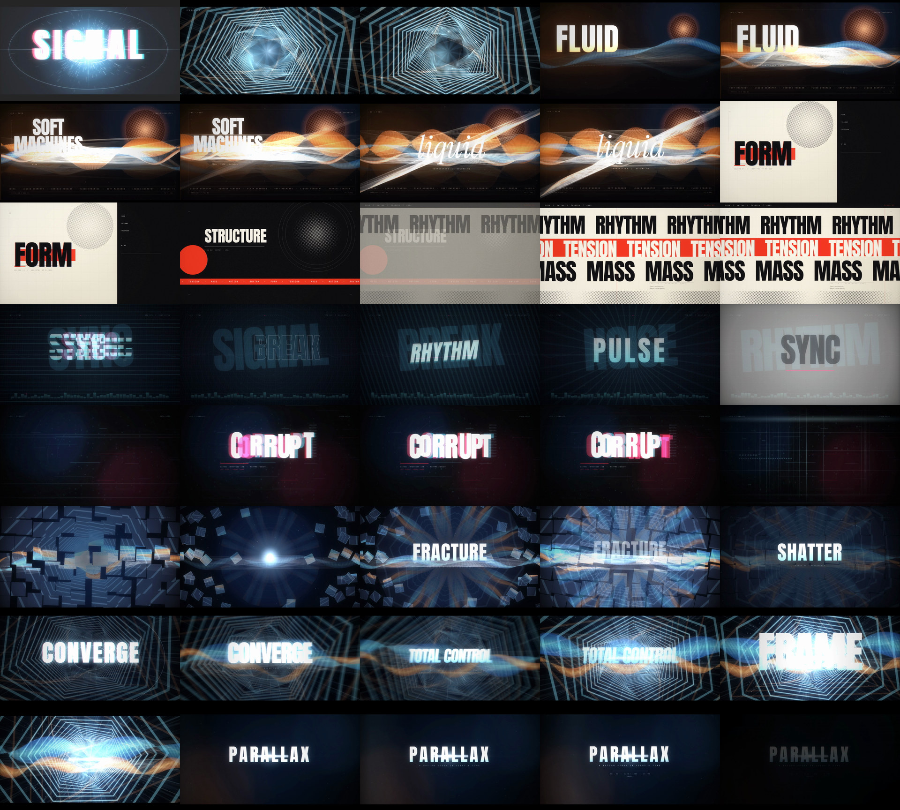

# PARALLAX — A Motion Study in Light & Time

A 40-second cinematic 2D motion-graphics film: **1920 × 1080, 16:9, 60 fps, 2400 frames,
frame-exact**. No 3D models, no footage, no templates. Every pixel is generated from
procedural 2D systems — projection maths, particles, typography, light and grain.

```
media/parallax_1080p60.mp4   ← the film (1920×1080, 60 fps, 40.0 s)
media/poster.png             ← hero frame
media/contact.png            ← one frame per second
```



## The edit

Eight chapters, cut on a 120 BPM half-second grid so the whole piece breathes in time.
Each chapter changes the *rules* of the image, not just its content.

| # | Chapter | Time | What it does |
|---|---------|------|--------------|
| 01 | **IGNITION** | 0.0 – 3.0 | Black, then detonation: a crosshair, a particle burst, a monolithic word that gets sucked into a singularity that opens into a hyperspace tunnel. Three beats of scale in the first two seconds. |
| 02 | **FEED** | 3.0 – 9.0 | Temperature flip to warm editorial: ribbons of light that twist in 2.5D, a halftone sun, a mirrored floor, cream-on-black type. The primary ribbon physically widens and rises across the chapter. |
| 03 | **FORM** | 9.0 – 15.0 | Hard cut to daylight brutalism: bone paper, black Anton, one red accent. A black mass and a halftone orb, then an inverted plate with a red ticker, then a Swiss poster of gliding type bands with a halftone floor. |
| 04 | **SYNC** | 15.0 – 20.0 | Ten half-second typographic beats, each with its own background field: slice, column-rise, outline echo, datamosh, shear, editorial, radial burst, stack, full inversion, smear. |
| 05 | **CORRUPT** | 20.0 – 25.0 | Signal failure: glyph rain, band displacement, per-glyph glitch, an acid-green negative, then a searching field of scan bars. |
| 06 | **FRACTURE** | 25.0 – 30.0 | The frame shatters into 84 tiles that explode, orbit and reassemble, folding into a kaleidoscope. |
| 07 | **CLIMAX** | 30.0 – 35.5 | Everything converges: tunnel, ribbons, particle swarm, kaleidoscope, anamorphic light, speed-ramped type. |
| 08 | **FINALE** | 35.5 – 40.0 | Resolution: one line of light, the title, a breathing button, and out. |

## How it is built

Pure 2D with simulated depth. There is no 3D engine; "depth" comes from:

- **Projection maths** (`effects/space.js`) — a pinhole camera, tunnel of polygon frames,
  radial light streaks, anamorphic flares.
- **2.5D ribbon** (`effects/ribbon.js`) — a strip of quads whose brightness comes from a
  virtual twist normal, so a 2D band folds and catches light like a surface.
- **Parallax layers** — every scene is composed from layers moving at different rates.
- **Post chain** (`engine.js`) — bloom (two-scale), chromatic aberration by channel
  tinting, radial speed blur, letterbox, vignette, animated grain.

Determinism: there is no `Math.random()` anywhere in the image path. Every "random"
value is a hash of its index (`core/noise.js`), so any frame can be rendered in
isolation and the film is perfectly scrubbable.

```
showreel/
  src/core/        platform, math, noise, draw primitives, text, surface pool
  src/effects/     space, ribbon, particles, patterns, typefx
  src/scenes/      s01…s08 — each scene is a pure function of time
  src/engine.js    scene compositing + transition library + post chain
  src/timeline.js  the edit: scene ranges, transitions, impacts, post curves
  render.mjs       offline frame-exact renderer → ffmpeg/x264
  web/             live in-browser player (same scene code)
tools/
  build-fonts.mjs  converts @fontsource WOFF→TTF (Skia) and copies WOFF2 (browser)
  serve.mjs        zero-dependency static server
```

### Design system

- **Type** — Anton (display), Space Grotesk (sans/UI), Instrument Serif Italic
  (editorial counterpoint), JetBrains Mono (technical microtype). Tracked with native
  `letterSpacing` so kerning survives animation.
- **Palette** — cold cyan `#8fe6ff` for machine chapters, warm amber `#ffb377` for the
  human ones, bone `#ece7db` / ink `#0d0d0f` / signal red `#e5331f` for the print beat,
  acid `#b6ff2e` for the glitch accent.

## Run it

```bash
npm install
npm run fonts          # WOFF → TTF for Skia + WOFF2 for the browser

npm run render         # full film: 1920×1080, 60 fps, CRF 17  → out/parallax.mp4
npm run render:preview # fast 960×540 / 30 fps pass           → out/preview.mp4
node tools/still.mjs 3.4 13.6 27.8   # PNG stills at exact times
node tools/poster.mjs 31.1 media/poster.png   # one hero frame

npm run web            # live player at http://localhost:5173
                       # same scene code, running in Chrome in real time
```

`render.mjs` flags: `--fps --scale --start --end --out --crf --preset`.

## Verified

- 2400-frame render completes with no exceptions; a 160-point sweep of the timeline
  (every 0.25 s) renders clean.
- Frame rate is locked: frames are generated from `t = i / fps`, not from the wall clock,
  so the output is exactly 60.000 fps regardless of render speed.
- Every cut is tested in both directions (`media/transitions.png`): no black gaps, no
  double-exposure, no frozen frames, and each chapter is already composed on its
  first frame.
- No empty regions: each chapter's lower third, margins and background carry content
  (tickers, rulers, indices, fields and dust).
- No `Math.random()` in the image path — every particle and jitter is a hash of its
  index, so scrubbing is exact and any frame is reproducible.
