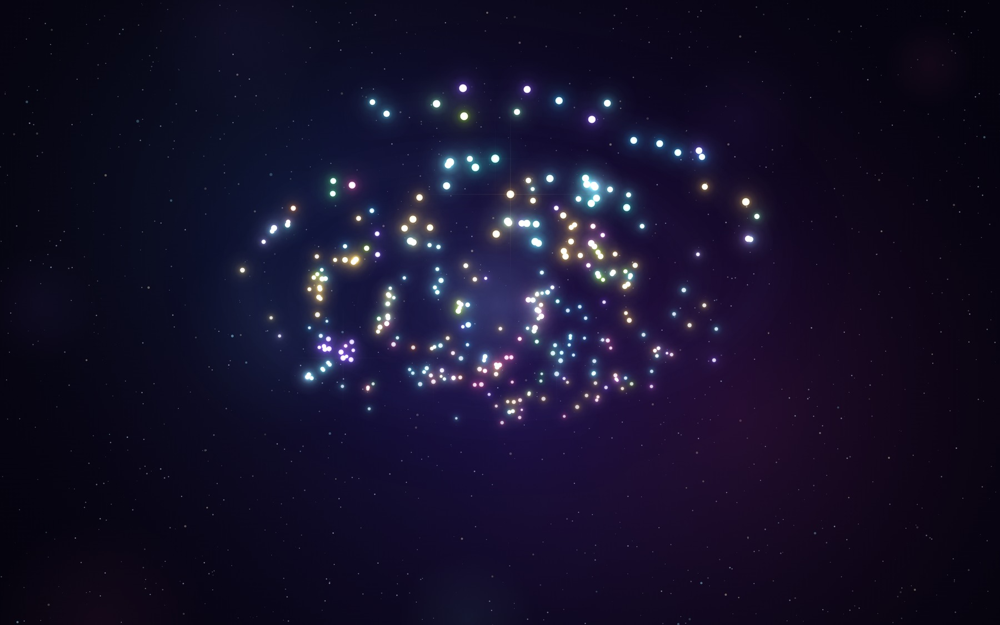
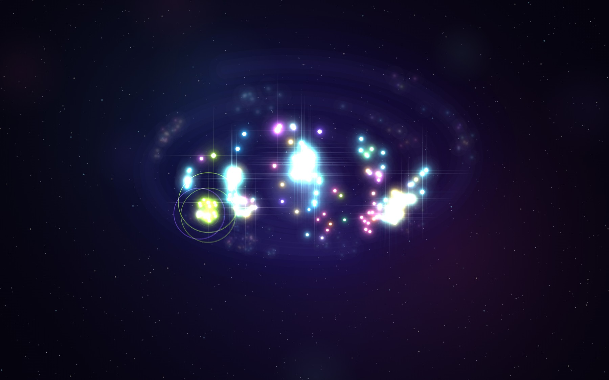
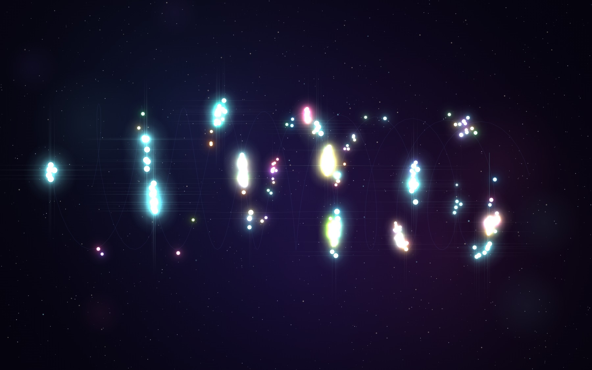
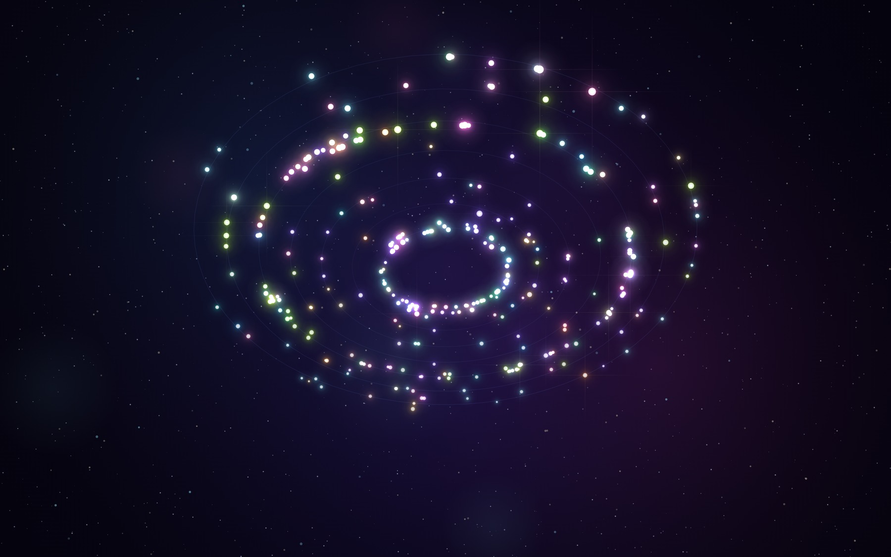

<div align="center">

# ✦ REPO COSMOS

**Point it at any GitHub repository and it turns the commit history into a living,
rotating galaxy — then plays that history back as music.**

Every commit is a star. Every author is a colour. Press play and the repo
composes itself in real time.

`zero npm dependencies` · `Node 18+` · `Canvas 2D` · `Web Audio`



<sub>^ the real thing: 300 commits of `react/react`, rendered by the app's own engine.
Colour = author, size = commit weight, position = place in history.</sub>

</div>

---

## What it does

1. You type `facebook/react` (or paste a `github.com` URL).
2. The server pulls the repo, its languages, its contributors and its
   **last 300 commits** from the GitHub REST API.
3. Those commits become **300 stars** arranged in a spiral galaxy:
   * position — place in history (the core is the oldest commit, the rim is today)
   * colour — the author (a 16-colour neon palette, assigned by first appearance)
   * size — commit *weight*: message length, merge commits, and same-day bursts
   * depth — a real 3D projection you can drag, spin and zoom
4. Hit **play** and a comet sweeps outward through time. Stars ignite as it
   reaches them, and **each ignition triggers a note** in a minor pentatonic
   scale, panned by the commit's position and sent through a noise-built
   convolution reverb. Dense days become runs of notes; quiet weeks become rests.

You are not looking at a screenshot of a repo. You are *listening* to one.

## Three ways to look at a repo

<table>
<tr>
<td width="33%"><br/><sub><b>in flight</b> — the comet sweeps outward, stars ignite behind it, the rest wait as ghosts</sub></td>
<td width="33%"><br/><sub><b>helix</b> — the history as a double strand</sub></td>
<td width="33%"><br/><sub><b>halo</b> — one ring per era</sub></td>
</tr>
</table>

## Features

| | |
|---|---|
| 🌌 **Three layouts** | `galaxy` (time flows outward), `helix` (a 9-turn double helix), `halo` (one ring per era) |
| 🎹 **Sonification** | per-commit plucked synth, pentatonic degrees per author, reverb, sub-bass drone |
| ▶ **Playback** | comet-driven timeline, ignition shockwaves, warp fast-forward, speed 0.5×–4× |
| 🔍 **Inspector** | click a star for the real commit message, date, and lazily-fetched `+/-` diff stats |
| 🎨 **The cast** | contributors ranked by commits in view — click one to dim their stars |
| 🖼 **Poster export** | one click composites both canvas layers plus a caption into a shareable PNG |
| ⌨ **Keyboard** | space, L, W, M, ← →, ? |
| 🧊 **Zero deps** | no React, no Three.js, no bundler, no `npm install` |

## Run it

```bash
node server.js          # → http://localhost:3000
```

That's it. Nothing to install.

Optional, and recommended — GitHub allows 60 unauthenticated requests/hour per IP
versus **5000** with a token:

```bash
GH_TOKEN=ghp_xxx node server.js
```

The token never reaches the browser: all GitHub traffic goes through the server.

## Keyboard

| key | action |
|---|---|
| `space` | play / pause the history |
| `L` | cycle layout — galaxy → helix → halo |
| `W` | warp (fast-forward through time) |
| `M` | mute / unmute the sonification |
| `←` `→` | scrub one commit at a time |
| `?` | help |
| drag / scroll / double-click | orbit / zoom / reset camera |

## How the sound works

`public/js/audio.js` is a ~250 line synth built on the Web Audio API:

* three detuned oscillators per note (triangle fundamental, sine octave, sine fifth)
  through a lowpass filter that closes as the note decays — a plucked-string envelope
* a stereo panner driven by the commit's hash, so the galaxy's arms drift across the field
* a **convolution reverb** whose impulse response is generated from decaying noise at boot
* merges add a bandpassed noise tick; every 16th commit drops a sub-bass anchor
* a four-voice drone (55 Hz / 82.5 Hz / 110 Hz / 164.81 Hz) with slow LFOs keeps
  the room from being silent between bursts of history

## The API

The server is ~380 lines of `node:http` with an in-memory + on-disk cache.

| endpoint | purpose |
|---|---|
| `GET /api/repo?repo=owner/name&limit=300` | aggregated repo + languages + contributors + commits |
| `GET /api/commit?repo=owner/name&sha=…` | per-commit additions / deletions / files (lazy, cached) |
| `GET /api/explore` | a hand-picked list of enormous repos to visit |
| `GET /api/health` | token presence, cache size, uptime |

Responses are cached for 10 minutes in memory and 6 hours on disk
(`.cache/cosmos/`), so re-visiting a galaxy is instant and costs zero API calls.

## Layout of the code

```
server.js            GitHub aggregation + static file server (no deps)
public/
  index.html         intro screen + HUD
  styles.css         the deep-space UI
  js/engine.js       the star engine: layouts, pseudo-3D projection, canvas rendering
  js/audio.js        the sonifier: plucks, reverb, drone
  js/app.js          data → UI wiring, playback transport, inspector, poster export
```

`engine.js` has no idea what a commit is beyond `{t, color, weight, seed}` —
which is why swapping in another data source (your Spotify history, your commit
log, your coffee intake) is a 20-line change.

## Notes

* GitHub returns a **301** for renamed repos; the server follows it, so
  `facebook/react` correctly lands on `react/react`.
* Sparklines, layout maths and the colour assignment are all deterministic —
  the same repo always produces the same galaxy.
* Sandboxes that intercept TLS: the server re-execs once with the system CA
  bundle so Node trusts the same certificates `curl` does. Set
  `COSMOS_NO_CA_BOOTSTRAP=1` to disable.

<div align="center"><sub>Built because commit graphs are boring and 300 stars are not.</sub></div>
