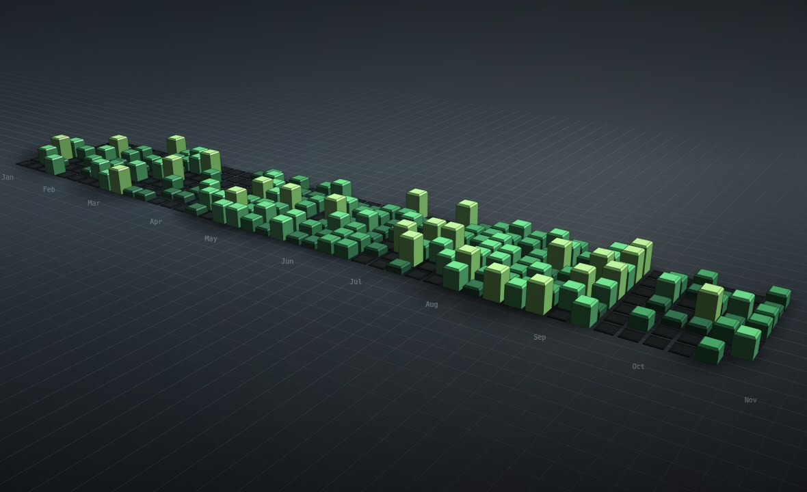

# Contribution City

**Your GitHub contribution graph, rebuilt as a beveled 3D city — and rendered by a
software renderer I wrote from scratch, inside a Blender-flavoured interface.**

No WebGL. No Three.js. No build step. No dependencies. One 2D canvas, ~700 lines of
math, and a fake contribution calendar that is deterministic per `@handle`.



---

## The idea

GitHub renders your year as 371 little green squares. This turns each square into a
building: rest days become empty lots, a two-commit day becomes a kiosk, a 40-commit
Tuesday becomes a tower. The whole thing is lit like a Blender studio scene, with a key
light you can move, two render engines, four palettes and a turntable.

The UI is shamelessly modelled on Blender 4.x: an outliner, a properties sidebar,
workflow tabs across the top, an orange render button, and `F12` to render a still.

## The renderer

Everything is drawn onto a single `<canvas>` with `ctx.fill()` and `ctx.stroke()`:

| Piece | How it works |
| --- | --- |
| Camera | Spherical orbit → look-at basis → perspective projection with configurable FOV |
| Geometry | Every tower is a 9-quad beveled box (4 sides, 4 chamfers, 1 top), 3,339 faces total |
| Sorting | Painter's algorithm — faces sorted back-to-front by camera-space depth |
| Shading | Key light (azimuth/elevation) + sky fill + Blinn–Phong specular + rim light |
| Atmosphere | Per-face distance fog into the background colour |
| Shadows | Sprite-projected contact shadows plus cast shadows thrown away from the sun |
| Clipping | Sutherland–Hodgman against the near plane, so you can fly the camera inside the city |
| Extras | Depth-faded studio grid, vignette, month labels on the floor, hover picking by screen-space AABB |

`EEVEE` gives you a crisp key light and tight highlights; `Cycles` gives softer bounce
light and a wider specular lobe. Neither is a real path tracer, obviously.

## Use it

```bash
# any static server will do
python3 -m http.server 8080
# then open http://localhost:8080
```

Deep links work too:

```
?user=torvalds&year=2024
```

## Controls

| Input | Action |
| --- | --- |
| Drag | Orbit |
| Shift + drag / right-drag | Pan |
| Scroll / pinch | Zoom |
| `1` `2` `3` | Isometric / front / top view |
| `W` | Wireframe |
| `T` | Turntable |
| `S` | Contact shadows |
| `F12` | Render a still, then save it as PNG |
| Double-click | Reset the camera |

The sidebar drives the sun, the key strength, tower height and emissive glow; the
outliner can hide the city, the floor or the key light.

## Files

```
index.html          markup + the Blender-ish chrome
assets/style.css    the whole UI theme
assets/data.js      deterministic contribution calendar generator (seeded PRNG)
assets/render.js    the software renderer
assets/ui.js        interaction, panels, render dialog, shortcuts
test/smoke.js       headless jsdom smoke test (fake 2D context, checks for runtime errors)
test/render-shot.js rasterises the real viewport to a PNG for eyeballing
```

## Dev checks

```bash
npm i -D jsdom @napi-rs/canvas     # test-only, not needed to run the app
node test/smoke.js                 # steps frames, prints stats, fails on any error
node test/render-shot.js 1180 720 test/shot.png
```

## Notes

- Contribution data is **invented**, not fetched. There is no token, no API call and no
  network request anywhere in the page. The same handle + year always produces the same
  skyline, so it is nice for screenshots.
- The current year stops at today; the remaining weeks render as empty lots.
- Everything is vanilla ES5-era JavaScript in plain `<script>` tags, so it also runs
  straight from `file://` if you prefer.
