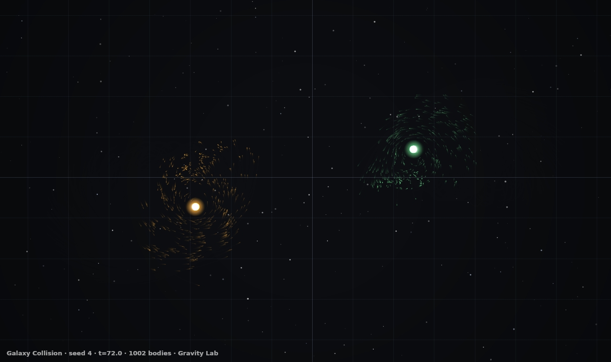
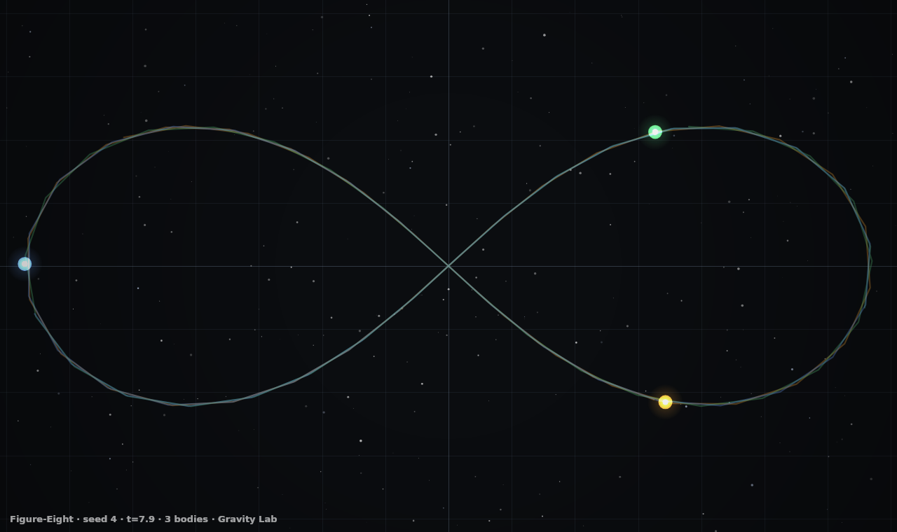

# Gravity Lab

**An N-body gravitational simulator with no dependencies.** Barnes–Hut quadtree
gravity, leapfrog integration, inelastic merging and eight hand-tuned
astrophysical initial conditions, rendered on three stacked 2D canvases.

No WebGL. No Three.js. No build step. No libraries. Vanilla ES5-era JavaScript
in plain `<script>` tags, so it also runs straight from `file://`.





---

## Use it

```bash
# any static server will do
python3 -m http.server 8080 --directory gravity-lab
# then open http://localhost:8080/gravity-lab/
```

Deep links work:

```
?preset=galaxies&seed=4&particles=1500
```

## The eight universes

| # | Preset | What it is |
|---|---|---|
| 1 | **Solar System** | Sun, eight planets, three Galilean moons, 420 belt rocks on softened-Keplerian circular orbits |
| 2 | **Binary Stars** | Two 900-mass stars in a close circular binary, ringed by an unstable circumbinary disc |
| 3 | **Galaxy Collision** | Two disc galaxies, ~1,140 stars, on a prograde off-centre pass — tidal tails rip out on first approach |
| 4 | **Figure-Eight** | Chenciner & Montgomery's proven three-body choreography; three equal masses chase each other round one closed curve |
| 5 | **Black Hole** | A 26,000-mass hole with a deliberately sub-Keplerian disc; matter loses support, spirals in and is swallowed |
| 6 | **Star Cluster** | A Plummer sphere: 1,200 stars sampled from the real cluster distribution function, in virial equilibrium |
| 7 | **Big Bang** | A marginally bound expanding sheet on a Hubble flow with m=3/5 overdensities; filaments condense out of nothing |
| 8 | **Cold Collapse** | A pressureless, spinless box of dust; free-fall collapse and violent relaxation into a lumpy core |

Every preset is **deterministic**: same seed, same particle count, same
universe, every time. The PRNG is a seeded mulberry32.

## Controls

| Input | Action |
|---|---|
| Drag | Pan (camera tool) |
| Scroll / pinch | Zoom about the cursor |
| Double-click | Frame the scene |
| Drag with **S** | Fling a new body — the arrow *is* its velocity vector |
| Drag with **H** | Place a black hole |
| Drag with **G** | Grab a body, release to throw it |
| Click with **X** | Erase |
| `space` | Pause / resume |
| `.` | Advance one step while paused |
| `1`–`8` | Presets |
| `V` / `Q` / `T` | Velocity vectors / Barnes–Hut quadtree / cycle trails |
| `R` / `F` | Rebuild from seed / frame the scene |
| `F12` | Save the current frame as a PNG |
| Right-click | Context menu |

The sidebar drives G, time step, substeps, Plummer softening ε, the Barnes–Hut
opening angle θ, merging, colour mode, trail persistence, glow and body size.

## The physics

**Force.** A Barnes–Hut quadtree collapses distant cells to their centre of
mass once `(cellSize / distance)² < θ²`, turning the O(n²) sum into
O(n log n). The force law is Plummer-softened, `a = GM·r / (r² + ε²)^{3/2}`,
so close pairs produce large but finite accelerations instead of singularities.

**Integration.** Leapfrog KDK — kick half, drift, kick half. It is symplectic,
so orbits stay closed over long runs instead of spiralling away the way plain
Euler would. Accelerations are cached across substeps, so each step costs
exactly one tree build and one force walk.

**Merging.** Perfectly inelastic, detected on a uniform spatial hash so it is
O(n) rather than O(n²). Mass and momentum are conserved exactly; radius follows
conserved volume, `r = ∛(r₁³ + r₂³)`.

**Circular orbits.** Discs are seeded with the *softened* circular speed,
`v = √(GM·r² / (r² + ε²)^{3/2})`. Using plain Kepler there is a few percent too
fast at small r, which is enough to start a satellite on an eccentric orbit it
never recovers from.

## Things this repo learned the hard way

The numerical test suite (`test/physics.cjs`) exists because several of these
failed silently at first:

- **The Moon does not fit.** Earth's Hill sphere at this mass scale is under a
  world unit, so a Luna is stripped by the Sun almost immediately. The moons
  live on Jupiter instead, where `r_H = a(m/3M)^⅓ ≈ 33`.
- **Prograde satellites die past ~0.49 r_H** (Hamilton & Burns 1992). A first
  build put Ganymede at 0.56 r_H and the Sun stripped it after ~1,200 steps,
  exactly as the limit predicts. At 0.44 r_H it survived but the solar tide —
  which scales as (d/r_H)³, so it is *not* a small perturbation out there —
  pumped its eccentricity to 0.10. The moons now sit at 0.25–0.40 r_H.
- **Truncated Plummer sampling.** Drawing the cluster's outermost star from
  X→0.995 throws a single star out to r ≈ 1,200 and wrecks the auto-fit.
  Sampling X ∈ (0, 0.9595) truncates at r = 6a, which is self-consistent: that
  shell already holds 96% of the mass.
- **A Hubble flow that is not bound makes no structure.** The first Big Bang
  expanded at ~2.5× the edge escape speed and stayed a featureless explosion.
  It is now tuned to 0.85 × escape, with angular overdensities for gravity to
  bite on.
- **`Math.pow(x, 1.5)` in the inner loop costs 4×.** Replacing it with
  `x * Math.sqrt(x)` and the recursive tree walk with an explicit stack took
  the black-hole preset from 55 ms/step to 10 ms/step.

## The renderer

Three stacked canvases:

| Layer | Contents |
|---|---|
| `bg` | Parallax starfield + world grid; repainted only when the camera moves |
| `scene` | Bodies and glow, faded each frame to leave comet trails |
| `overlay` | Velocity vectors, quadtree debug view, hover readouts, vignette |

- Glow comes from a pre-baked sprite LUT (64-entry blackbody ramp) drawn with
  `lighter` compositing — an order of magnitude faster than filling a fresh
  radial gradient per body.
- **Trails fade with `destination-out`, not a translucent fill.** On a
  transparent layer, compositing `rgba(bg, a)` *accumulates alpha*: after ~200
  frames the scene canvas is an opaque sheet that hides the starfield beneath
  it, and 8-bit rounding leaves permanent ghost arcs behind each planet.
  `destination-out` scales destination alpha by (1−a) instead, so trails decay
  to genuinely transparent.
- The fade is applied every second frame with `A = 1 − (1 − t/2)²`, because
  8-bit compositing has fixed points at `round(a·(1−A)) == a`; a gentle A parks
  those fixed points at a ≤ 6/255 (visible ghosts), while A ≈ 0.2 pushes them
  to a ≤ 2 (invisible).
- Trails are sampled by **distance travelled**, not by frame, so a preset whose
  period is 719 frames still draws its whole curve.

## Dev checks

```bash
npm i -D jsdom @napi-rs/canvas   # test-only, not needed to run the app

node test/physics.cjs            # numerical acceptance: drift, escapes, Hill spheres,
                                 # Barnes–Hut error vs exact, merge conservation, determinism
node test/physics.cjs solar      # one preset, verbose

node test/smoke.cjs              # jsdom: boots the page, drives every preset, tool,
                                 # slider, key and menu; fails on any error or NaN

node test/render-shot.cjs galaxies 220 out.png   # rasterise a real frame to look at
```

`test/physics.cjs` is the interesting one: it verifies Barnes–Hut against the
exact O(n²) sum at four values of θ, checks that the figure-eight closes on
itself after one period, that planets hold their semi-major axes, that no
Galilean moon ever exceeds 0.47 r_H, and that merging conserves mass, momentum
and volume to machine precision.

## Files

```
index.html          markup + the Blender-ish chrome
assets/style.css    the whole UI theme
assets/physics.js   quadtree, integrator, merging, the eight presets
assets/render.js    the three-layer canvas renderer
assets/ui.js        main loop, camera input, tools, panels, deep links, capture
test/physics.cjs    numerical acceptance test (plain Node, no DOM)
test/smoke.cjs      headless jsdom smoke test with a strict recording 2D context
test/render-shot.cjs rasterises the real viewport to a PNG via @napi-rs/canvas
```

## Honesty notes

- Energies shown in the HUD are approximate: potential energy is estimated from
  the same Barnes–Hut walk, and with θ > 0 the force is not exactly conservative,
  so small drift is expected and displayed rather than hidden.
- Presets are *illustrative*, not to scale. The solar system exaggerates planet
  masses ~10–20× because a true-ratio system is dynamically invisible at this
  size; the README says so instead of pretending otherwise.
- No network requests anywhere in the page. No tokens, no telemetry.
