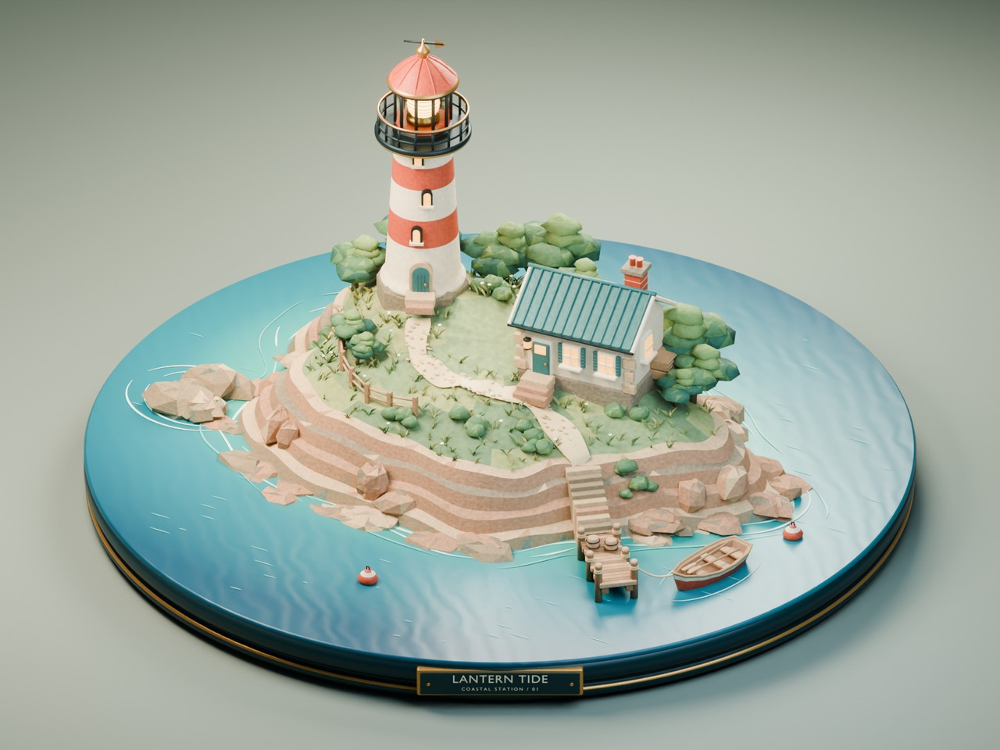

# Lantern Tide

A miniature coastal station on an enamel display plinth: a striped lighthouse with a glowing Fresnel lens, a keeper’s cottage, wind-shaped pines, and a dinghy moored below the sandstone cliffs.



The island, buildings, boat, water, and studio set are built entirely by [`render_scene.py`](render_scene.py). The Blender scene contains a cylindrical UV atlas, a procedural erosion modifier stack, editable Geometry Nodes pebble instances, and—with the animation pipeline—an editable camera orbit. No models, textures, or HDRIs are downloaded. Upstream: [Blender](https://github.com/blender/blender) and [Cycles](https://github.com/blender/cycles).

## Animate and render with GitHub Actions

See the [CPU pipeline instructions](../blender_pipeline/README.md). A successful run makes the editable `.blend`, H.264 MP4, poster, contact sheet and QA reports available as the **`lantern-tide`** artifact. Open the `.blend` in Blender 5.0.1 or later; scrub the camera animation, or use **F12** to re-render a frame.

## Render the showcase still

From the repository root, with a Blender 5.0.1 installation on your `PATH`:

```bash
blender --background --factory-startup --python-exit-code 1 --python lantern-tide/render_scene.py
```

Or use the [CPU rendering wheel environment](../blender_pipeline/README.md) and run `python lantern-tide/render_scene.py`. Add `--width 840 --samples 18` for a draft (after `--` with the Blender executable). The full still is 1600 × 1200 and saves to the ignored `lantern-tide/out/` folder together with the editable still scene. The README image is a reduced-size render of that still.
