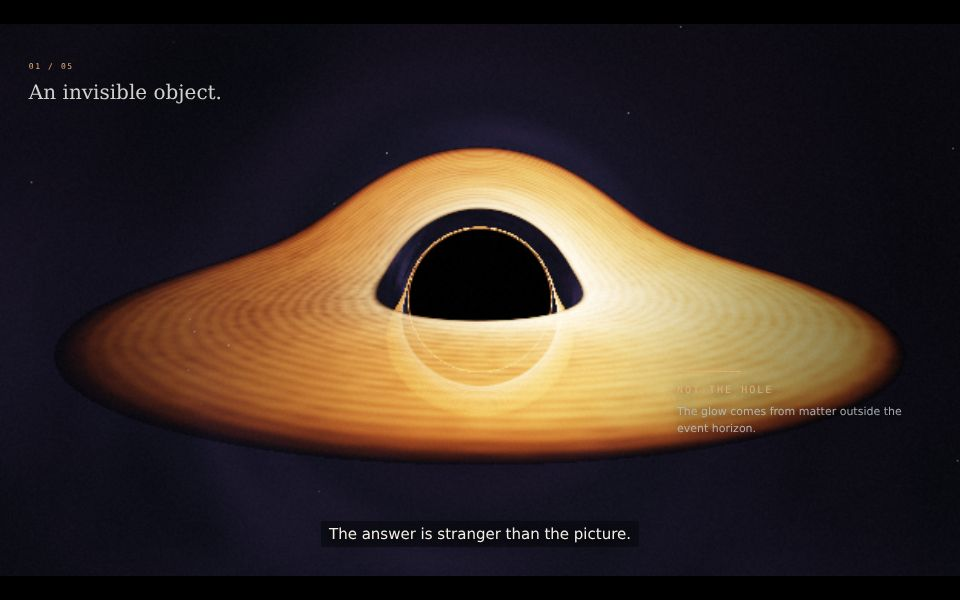

# LIGHTFALL
### The light that couldn't escape.

An original **74-second narrated cinematic science film** about black holes,
accretion disks, bent light, and the distinction between a shadow and a horizon.



## Watch the working project

```sh
# From the repository root. No build or dependency installation needed.
python3 -m http.server 8090 --bind 0.0.0.0 --directory lightfall
```

Open **http://localhost:8090** and click **Enter the dark**. The delivered audio
is real generated narration mixed with an original synthesized underscore.
Everything needed for browser playback is local: no CDN or API calls.

On a phone, landscape provides the intended cinematic composition. Portrait
retains the full horizontal field of view and adds vertical space.

## Delivered

- A complete browser film, with a synchronized audio clock and optional captions.
- Five generated narration stems and a complete 74-second music/voice mix.
- [Full timed narration and edit script](docs/script.md).
- [Music and sound design plan](docs/sound.md).
- [Scientific references, equations and limitations](docs/science.md).
- All Three.js / JavaScript / GLSL / GSAP / HTML / CSS source.
- Deterministic MP4 export and browser acceptance-test tools.

## Visual construction

The main image numerically bends rays around a non-rotating black hole and
samples a procedural emitting disk at plane crossings. A paused GSAP timeline
choreographs camera inclination, distance, diagram transitions and the ending.
An independent Three.js scene gives a schematic 3D explanation of light paths.
A second diagram compares the horizon radius with the apparent shadow radius.
The palette is restrained amber, graphite and glacial cyan.

This is not a slide deck or a sequence of fetched stock images. The scientific
view, geometry, photons, disk turbulence, stars and grade are code-generated.

## Controls

- Play / pause, restart and a draggable seek bar.
- CC toggles sentence captions; Sound toggles the complete mix.
- Space: play/pause. R: restart. M: sound. Arrows: seek ±5 seconds.
- Fullscreen depends on browser/iframe permission.
- Hidden tabs pause automatically. Click play to unlock sound on mobile.

The MP3 master is used in browsers for broad decoder compatibility; the AAC
master is used for MP4 export. Both represent the same mix.

## Export MP4

Install Node 22+, Python 3, FFmpeg, and a local Chromium/Chrome. Only export and
tests need Node packages; browser playback does not.

```sh
cd lightfall
npm install
# Terminal 1
npm run serve
# Terminal 2 — use the path to your Chrome/Chromium executable
CHROMIUM_PATH=/usr/bin/chromium FFMPEG=ffmpeg npm run render -- \
  --url http://127.0.0.1:8090 --output /path/to/LIGHTFALL.mp4
```

On macOS set CHROMIUM_PATH to your Chrome executable inside its application
bundle. On Windows, set the environment variables using PowerShell or `cmd`.
Alternatively, install `@sparticuz/chromium` for an appropriate Linux/Lambda
runtime. Its binary may need extra system libraries; ordinary desktop Chrome
is the simpler local choice.

The renderer captures deterministic frames, streams them to FFmpeg and muxes
the supplied master audio. Defaults: **960×540, 24 fps, 74 seconds**, H.264 / AAC,
fast-start MP4. Override `WIDTH`, `HEIGHT`, `FPS`, and `RAY_SCALE` to change the
export. Example, GPU-assisted high quality:

```sh
WIDTH=1920 HEIGHT=1080 FPS=24 RAY_SCALE=1 \
CHROMIUM_PATH=/usr/bin/chromium npm run render
```

The ray view is rendered below display resolution and linearly upsampled to
keep the expensive ray integration usable. Browser default is 0.65; exporter
default is 0.4. The session MP4 uses 0.5. Typography and 3D schematic lines are
captured at the full output resolution. Increase `RAY_SCALE` on a real GPU.
Software-only rendering can take tens of minutes or longer. This is not an
instant or real-time offline export.

The script intentionally removes interactive controls from exported frames.
The film title appears in the last composition. Subtitles remain burned in.

## Rebuild audio

The voice stems are provided. The exact narrator is not reproduced locally:
replace the five stems if you want a different narrator. With the supplied
stems, the mix is reproducible:

```sh
FFMPEG=ffmpeg bash tools/mix.sh
```

`tools/score.py` makes the underscore using Python's standard library. The
mixer slows the supplied voice to 90%, places paragraphs at 0, 12, 27, 41 and
57 seconds, adds the score and timed effects, and limits the result. No sound
library or music subscription is required.

## Tests

With the server running:

```sh
CHROMIUM_PATH=/usr/bin/chromium npm test
```

The automated mobile check covers audio-clock playback, pause, all five chapter
seeks, mute, captions, end card, replay, horizontal overflow and HTTP/JS/shader
errors. The desktop view is inspected at five chapter timestamps.

## Hosting / embedding

Upload this entire directory, preserving its structure, to any HTTPS static
host. The repo's Pages workflow includes `/lightfall/` on its next main-branch
deployment. Google Sites: Insert → Embed → URL → your hosted `/lightfall/` URL.
Allow adequate height, preferably a landscape frame. Playback requires a user
click; fullscreen and autoplay may be restricted by the parent iframe.

## Honest limits

This is an illustrative numerical model, **not a calibrated astrophysical
simulation or real telescope data**. Its Schwarzschild orbit integration has a
finite step budget, approximate camera initial conditions and artistic
radiative transfer. Three.js light-path splines are explicitly schematic.
No scientific inference should be made from rendered pixels. See the full
[science notes](docs/science.md).

Voice is synthesized, not a human studio recording. The original generated
score and master are mono, not spatial/binaural/Atmos. Captions are
sentence-timed rather than phoneme-aligned. No claim of certified broadcast
loudness, 4K mastering or guaranteed mobile frame rate is made.

Three.js r180 is vendored under MIT. GSAP 3.14.2 is vendored under GreenSock's
standard license, with its copyright/license header and upstream README
preserved; consult https://gsap.com/standard-license for its terms.
