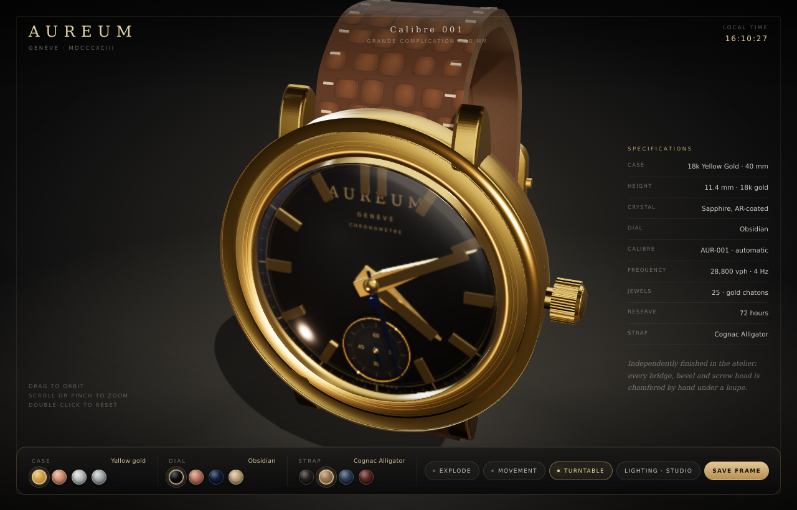

# AUREUM — Calibre 001

A procedurally generated, presentation-grade wristwatch built with **three.js**.
Every part of the watch — case, lugs, crown, dial, indices, hands, calibre, rotor,
strap, buckle — is generated in code from primitives, lathes, extrusions and
canvas-painted texture atlases. There are no imported models, HDRIs or image
files: the whole object is *computed* at load time.



---

## Run it

The page uses an import map and ES modules, so it must be served over HTTP
(`file://` will not work). From the repository root:

```bash
cd /home/user/Parth-
python3 -m http.server 8080 --bind 0.0.0.0
# open http://localhost:8080/luxury-watch/
```

Any static server works. `npm run watch` (from the repo root) does the same thing.
No build step, no bundler, no network access required at runtime.

**Requirements:** a WebGL2-capable browser. three.js r187 is vendored under
`vendor/three/` (MIT), so the page works fully offline.

---

## What is modelled

| Assembly | Details |
| --- | --- |
| **Case** | Ø40 × 11.4 mm lathe-turned profile, stepped bezel, polished flank, chamfer edges, drilled lug holes, screw-down crown with fluted grip and end cap. |
| **Lugs** | Four tapered, down-curved lugs with a polished top facet and a brushed underside, spring bars. |
| **Crystal** | Double-domed sapphire, `transmission` + `ior 1.77`, anti-reflective coating faked with a faint blue-violet sheen, plus an inner flange ring. |
| **Dial** | Obsidian lacquer with a canvas-painted *guilloché* base, sunburst normal map, printed minute track with five-minute numerals, applied gold batons with faceted tops, applied logo plaque, small-seconds sub-dial (snailed) at 6 o'clock. |
| **Hands** | Faceted dauphine hour/minute hands, blued-steel small seconds, counterweighted tails, polished bevels; real time driven from `Date`. |
| **Calibre** | Openworked three-quarter bridge plate with five apertures, Côtes de Genève striping, 34/26/24/18-tooth wheels, ratchet and crown wheel, six gold chatons with ruby jewels, six blued screws, balance wheel with hairspring, balance cock, engraved rotor on a track, engraved barrel plaque. |
| **Case back** | Exhibition back with sapphire window and a stepped gold ring. |
| **Strap** | Hand-stitched alligator: two curved, tapered loops with scale-pattern relief + normal map, leather edge paint, instanced saddle stitching, keeper loop, gold pin buckle and deployant hardware. |
| **Presentation** | Procedural studio HDRI (three-point softbox rig baked into a PMREM cube), contact shadow, gradient floor, filmic tone mapping, vignette. |

The watch contains **103 meshes / ≈66k triangles**, instanced indices, screws and
stitches (**76 instances**) across **18 physically based materials**.

---

## Interaction

| Input | Action |
| --- | --- |
| Drag / one-finger drag | Orbit (damped, with inertia) |
| Wheel / pinch | Zoom (clamped to a useful range) |
| Double-click / `R` | Return to the hero pose |
| `E` | Explode / assemble the case, dial, calibre and rotor |
| `M` | Flip to the movement view |
| `L` | Cycle lighting: Studio → Soft → Dramatic |
| `Space` | Turntable |
| `⌘/Ctrl + S` | Save the current frame as a PNG |

The dock also exposes four cases (yellow / rose / white gold, platinum), four
dial colours (obsidian, midnight, salmon, champagne) and four strap colours
(cognac, black, navy, oxblood). Every switch is animated: metals cross-fade
through a shared shader uniform, the strap is hidden while the case turns so the
lugs stay readable, and the spec sheet updates in step.

### Debug / automation API

```js
const a = window.__aureum;              // { THREE, watch, materials, studio, scene, camera, renderer, orbit, state }
a.orbit.setPose({ theta: 0.36, phi: 1.13, radius: 118 }, 800);
a.orbit.setTarget(0, 0, -5);
a.orbit.autoRotate = false;
a.watch.setStrapOpacity(0);            // 0..1, fades the strap for the movement view
a.watch.setExplode(0.8);               // 0..1, exploded assembly
a.watch.setCaseMetal('rose');          // yellow | rose | white | platinum
a.watch.setDial('salmon');             // obsidian | midnight | salmon | champagne
a.watch.setStrap('oxblood');           // cognac | black | navy | oxblood
a.materials.sapphire.transmission = 0; // cheapest quality/perf trade-off
```

Coordinates are in millimetres, dial faces **+Z**, 12 o'clock is **+Y**.

---

## How it is built

```
luxury-watch/
├── index.html          markup, import map, dock / spec sheet / loader
├── styles.css          dark-lacquer chrome, gold hairlines, responsive dock
├── src/
│   ├── main.js         boot, render loop, resize, UI wiring, keyboard, save
│   ├── watch.js        the watch itself: case, dial, calibre, strap, poses
│   ├── geometry.js     reusable builders: batons, hands, gears, hairspring, extrusions
│   ├── materials.js    the PBR palette + cross-fade uniform plumbing
│   ├── textures.js     every canvas texture (guilloché, Geneva stripes, perlage, leather…)
│   ├── environment.js  procedural studio HDRI, lights, contact shadow, floor
│   └── orbit.js        dependency-free damped orbit camera
├── vendor/three/       three.js r187 (module + core)
└── test/               smoke test and optional headless QA rigs
```

**Procedural texturing.** A single `document.createElement('canvas')`-based
pipeline paints: a 2048² guilloché dial, sunburst/anisotropy normals, Côtes de
Genève stripes and their normals, perlage, brushed-metal anisotropy, a rotor
engraving, the buckle's leather grain, and the studio environment (a cube of
emissive softbox panels, 64²–512² per face). Nothing is fetched.

**Material system.** Metals are `MeshPhysicalMaterial` with hand-tuned `ior` /
`reflectivity` / roughness ramps: yellow and rose gold get warm tinted
reflectance, white gold and platinum stay neutral and slightly cooler. Each metal
PBR pair is mixed at runtime by lerping `color`, `metalness`, `roughness` and
`envMapIntensity`. Sapphire uses transmission with a thin-film tint on the AR
coating; the dial adds a clearcoat layer so the lacquer reads wet under the
softboxes; the strap combines a tiled alligator map with a normal map and a
clearcoat weighted toward the scaled centre.

**Lighting.** No HDR file: `environment.js` renders a small scene of emissive
planes into a `PMREMGenerator` cube, giving believable elongated highlights on
the case flanks. Three moods swap exposure, key intensity and the cube's
brightness. An in-case point light (intensity 150, distance 70) lifts the calibre
so the movement is legible when the strap/case are exploded or hidden.

**Performance.** Textures are generated once and shared; indices, screws and the
96 stitches are `InstancedMesh`; renderer pixel ratio is capped at 2; the loop
pauses when the tab is hidden; `prefers-reduced-motion` collapses all tweens and
disables the turntable. Typical frame cost at 1440×900 is ~220 draw calls and
~165k triangles.

---

## Tests

```bash
# From the repository root — no browser needed.
node luxury-watch/test/smoke.mjs
```

`smoke.mjs` stubs a 2D canvas, builds the entire watch and every material,
then validates every geometry buffer: no NaNs, sane winding, expected triangle
counts, material parameter ranges and texture-matrix consistency. It is the fast
guard against a typo in a shader uniform or a degenerate lathe.

The two headless rigs are optional and need `puppeteer-core`:

```bash
npm i --no-save puppeteer-core@23
python3 -m http.server 8080 --bind 0.0.0.0 &
node luxury-watch/test/shots.mjs   # hero / movement / mobile PNGs (~2.5 min on swiftshader)
node luxury-watch/test/ui.mjs      # clicks every case, dial, strap and toggle; exits 1 on console errors
```

Both accept `WATCH_URL` and `SHOT_DIR`; `shots.mjs` and `ui.mjs` default to a
bundled Chromium build and may need their `executablePath`/flags adjusted for a
local Chrome.

---

## Notes & limits

- Geometry is authored at real scale (mm), so the camera near/far planes and the
  light falloff stay physically meaningful.
- The sapphire transmission pass is the most expensive part of the frame; on very
  weak GPUs drop the sapphire's `transmission` to `0`
  (`a.materials.sapphire.transmission = 0`) for a large win.
- The strap is a single curved sweep rather than a full physical simulation, so
  it holds the display "hoop" pose on its own; the deployant is simplified.
- three.js is MIT licensed; the watch code in `src/` is yours to use.
