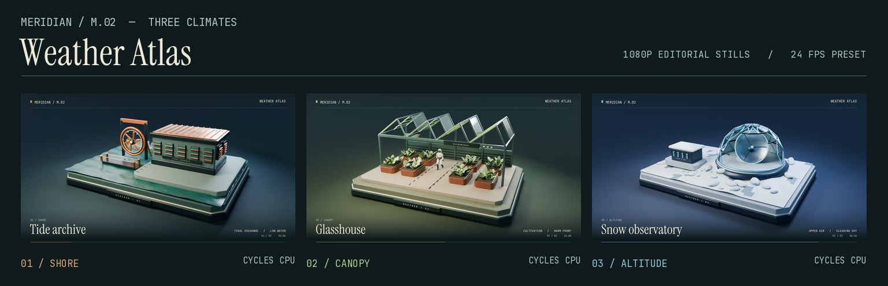

# Meridian M/02 — Weather Atlas

An eight-second miniature field atlas: a low-water **Tide Archive**, a working **Glasshouse**, and a **Snow Observatory**. A frame-locked cut moves from the current rotor to a surveyor and moving ventilation louvers, then to the scanning reflector. The edit adds typographic labels, a synthesized stereo score and a selectable English sound-caption track.

M/02 adds set generation, clipped-module architecture, layered shading, target-based gait and measured repair **on top of** the M/01 clock, Cycles CPU worker/receipts, and FFmpeg delivery checks. It has its own CLI, output directory and [Actions workflow](../.github/workflows/render-meridian-m02.yml). [M/01](../production/README.md) and [Lantern Tide](../lantern-tide/README.md) are unchanged. Their existing Manim and optional Remotion path are not needed for M/02.



**[Download the 1080p film, editable Blender ZIP and QA](https://github.com/parthoriganal/Parth-/actions/runs/44255533345/artifacts/14405802634)** (GitHub sign-in; available until December 18, 2026). The film is 8 seconds, 24 fps, with three English closed captions. The master was rendered on standard CPU runners at 1152×648 native plates, then edited at 1920×1080.

See [Verification](VERIFICATION.md) for the run receipts, actual rendered comparisons, verified features and open limits.

## Reproduce on CPU

Use Linux x86-64, Python 3.11, and Blender 5.0.1's headless `bpy` wheel. On Ubuntu/Debian install `libgl1 libice6 libsm6 libx11-6 libxext6 libxfixes3 libxi6 libxkbcommon0 libxrender1`; the hosted setup action installs the same prerequisites. There is no `blender` or FFmpeg binary needed on `PATH`. Use the build lock (Blender, NumPy, Pillow, Trimesh) and media lock (Pillow, NumPy and `imageio-ffmpeg`):

```bash
python3.11 -m venv .venv
source .venv/bin/activate
python -m pip install --only-binary=:all: --require-hashes -r blender_pipeline/requirements-build.lock
python -m pip install --only-binary=:all: --require-hashes -r meridian_m02/requirements-media.lock

python -m meridian_m02 plan --preset draft
python -m meridian_m02 build --preset draft
python -m meridian_m02 render --threads 2          # resume or render all batches
python -m meridian_m02 stage                       # ordered hashes/decodes + all-plate pixel QA
python -m meridian_m02 compose
python -m meridian_m02 export
```

Use `--root PATH` **before** the verb to keep separate versions, or use `--preset master` on build. `matrix` prints the batch IDs and ranges; `render --shard tide-00` runs one independent batch. `draft` is 768×432 at 12 fps with 640×360 plates (6 samples); `master` is 1920×1080 at 24 fps with 1152×648 plates (12 samples, denoised and scaled in the edit). Neither claims native 1080p rendering of the complete film. The four-CPU-worker cap limits concurrent memory per job; a six-job matrix fan-out handles the 16 master batches. Pushes touching the M/02 pipeline run draft by default. Add `[m02 master]` to the triggering commit message for a master run; once the workflow is on the default branch it can also be dispatched manually. For edit/mux retries, the optional `plate_run` input uses a completed same-branch run with passing Blender batches and rendered evidence. On an eligible push, the exact commit-message trailer `M02-Plate-Run: <run-id>` selects the same reuse path. It verifies the original receipts and runs media QA again; it does not re-render the plates.

`out/meridian-m02/delivery/` holds `weather-atlas.mp4`, `weather-atlas-editable.zip`, `contact-sheet.jpg`, and source `.blend`, WAV, SRT, checksums and JSON reports. The ZIP includes a `rebuild/` source subset and font licenses. A generated `.blend` has packed typography and native editable objects, camera/aim/lens tracks, control targets, materials and lights. The score and captions are separate from the .blend. To retime cuts or change templates, edit the board and rebuild; if editing the .blend in Blender, use Blender's own render controls or intentionally create a new bundle, since the worker rejects modified files under old hashes.

## Storyboard and reusable sets

[`weather-atlas.json`](weather-atlas.json) is schema **2**. The library is independent of shot order. Each shot references a named `set`; that set can be instantiated in multiple shots without duplicating its seed/material/module definition. On the common 24 Hz clock, the default cuts are **0:00.000**, **0:02.500**, **0:05.500**, ending at **0:08.000**. Use even tick lengths for draft; bounds are 36–120 ticks per shot, up to six ordered shots. Camera keys are `[normalized_time, position_xyz, aim_xyz, lens_mm]`; time starts at 0 and ends at 1. Aperture zero disables depth of field. Each shot also sets the light recipe, exposure, text, cue note and sound caption.

| Set `kind` | `modules` | Built elements |
|---|---:|---|
| `tidal` | 3–7 | Seeded wave surface, breakwater caissons and shutter bays, cast quay, animated current rotor |
| `glasshouse` | 3–5 | Repeated sawtooth northlights, translucent panels, linked planted beds, ventilation motor and IK surveyor |
| `alpine` | 10–16 | Seeded snow heightfield and linked rocks, open geodesic shell, two-axis reflector |

Every set accepts an unsigned 32-bit `seed` and a six-digit sRGB `accent`. Trimesh audits the closed extruded solids before authoring them; open surfaces, glazings and architectural ribs are not all inferred to be watertight. The sculpted wave field is static geometry, not a fluid simulation. The lighting recipes use Cycles multiple-scattering sky and temperature-controlled Sun/area lamps; intensity is authored, not a measured reconstruction of a real site.

[`examples/lichen-crossing.json`](examples/lichen-crossing.json) uses the same five-bay seeded glasshouse **twice**, with different camera, light and clock settings. To build it without editing Python:

```bash
python -m meridian_m02 --root out/m02-variant build --board meridian_m02/examples/lichen-crossing.json
```

## Visual preflight and repair

```bash
python -m meridian_m02 --root out/m02-faults build --prove-repairs
python -m meridian_m02 details  # requires a built clean bundle; writes separate inspection stills
```

- `build` projects bounded structure and plinth geometry for **every integer frame** and renders midpoint, opening and closing Cycles probes. If a lens track creeps outside the safe inset, bounded focal scaling preserves the camera and look-target paths. It does not redirect a camera that points away from its set.
- It measures display-referred luma percentiles, highlight/shadow coverage, global spread and crop edge energy. On the midpoint, bounded exposure corrections are rerendered, at most three times. Opening/closing failures stop the build. Dim films intentionally below this project's thresholds require a different policy, not global claims of defective imagery.
- In glasshouse, the evaluated ankle/sole vertices and the **authored path mesh** are sampled all the way through the shot. A recoverable plane offset is corrected by rekeying pelvis and world-space IK controls to that path. This is not arbitrary terrain contact or a general collision solver.
- `stage` rejects bad plate receipts, malformed, missing or near-uniform frames, visually under/overexposed frames, and takes with insufficient rendered motion. It does not automatically fix arbitrary occlusion, flicker or missing objects. `details` renders fixed-camera motion pairs, a layer-bypass comparison, a light comparison, close gait, bright recovery and a deliberately unlit rejected render. Proof-only roots are kept out of the film.

`proof/<shot>/inspection.json`, `bundle/scene-qa.json`, `details/detail-qa.json`, `image-qa.json`, and `delivery/delivery-qa.json` distinguish the candidate and final pixel results from the measurements of geometry, animation and media. The Actions `m02-rendered-evidence` artifact includes the inspection PNGs. `.blend` sources are reopened before the plan is admitted to the workers.
