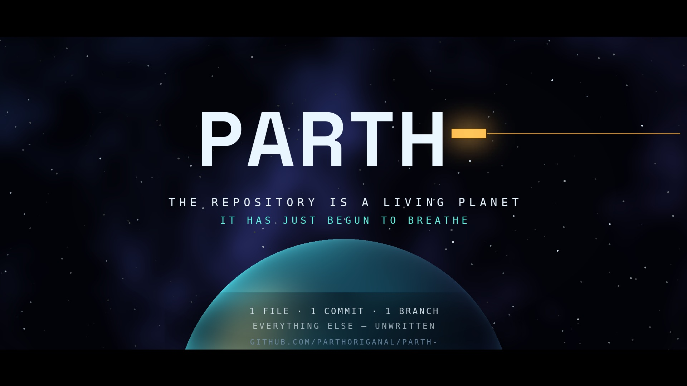

# PARTH- · THE REPOSITORY IS A LIVING PLANET

An original **45-second, 1920×1080, 30 fps** cinematic motion-graphics film generated from the
**verified, real DNA** of [`parthoriganal/Parth-`](https://github.com/parthoriganal/Parth-) — no stock
footage, no templates, no invented statistics, no copyrighted music.



**▶ Watch:** `out/parth-living-planet.mp4` (H.264 + AAC) — or open the preview page (below).

---

## Why this film looks the way it does (the honest concept)

When this film was made (2026-10-30), the repository contained exactly:

| Verified fact (`gh repo view` + GitHub API + git) | Value |
|---|---|
| Files | `README.md` only — 1 line, 8 bytes: `# Parth-` |
| Commits | 1 — `5a41087` “Initial commit” (2026-10-30 08:31 UTC) |
| Default branch | `main` |
| Languages / topics / description | none detected |
| Releases · stars · forks | 0 · 0 · 0 |

So instead of faking a mature-codebase montage, the film treats the repo as what it truly is:
**a proto-planet at the moment of creation.** The hero motif is the trailing hyphen in `Parth-` —
an unfinished name, rendered as cursor, orbit-line and finally an open horizon.

| Act | Time | On screen | Real data behind it |
|---|---|---|---|
| I · VOID | 0–9 s | One breathing point of light | “Every world begins with a single line.” |
| II · THE FIRST COMMIT | 9–19 s | A meteor strikes; shockwave becomes an orbit | Commit `5a41087`; branch `main`; chips `1 COMMIT · 1 BRANCH · 1 FILE` |
| III · THE MONOLITH | 19–31 s | A glass cathedral; three dormant rivers of light | `README.md`, its only line shown verbatim; languages honestly labelled **“not yet chosen”** |
| IV · PROTO-PLANET | 31–40 s | Dust gains gravity; the commit becomes a moon | “No releases. No stars yet. Only gravity.” (0 releases / 0 stars) |
| V · PARTH- | 40–45 s | Title resolve over a planetary horizon | `1 FILE · 1 COMMIT · 1 BRANCH — everything else, unwritten` |

Every number and word of repository data lives in [`film-data.json`](film-data.json) with provenance.
**No private code, email addresses, or secrets appear in the film.**

**Design system (created for this repo, which had none):** Void `#03040A` · Genesis Cyan `#5FF5E2` ·
Meteor Amber `#FFB347` · Nebula Violet `#7C5CFF` · Ice `#EAF6FF`. Type: Space Grotesk + DejaVu Sans Mono.
Render seed `541087` is derived from the first commit SHA, so every render is bit-for-bit reproducible.

---

## Project layout

```
motion-film/
├── index.html          preview page: film player + chapters, live stage, poster, provenance
├── server.js           zero-dependency static server with Range support (video seeking)
├── src/film.js         live "design stage" — same timeline/palette/facts on Canvas 2D
├── film-data.json      the ONLY place repo facts live (verified 2026-10-30)
├── render/
│   ├── render.py       master renderer (Pillow + numpy → frames → ffmpeg → MP4; also --still/--poster)
│   └── audio.py        original score, fully synthesized with numpy (no samples)
├── assets/fonts/       Space Grotesk (OFL) + DejaVu Sans Mono
├── tools/              local ffmpeg binary goes here (not committed — see setup)
└── out/
    ├── parth-living-planet.mp4   final film (generated)
    ├── poster.jpg                key frame / poster (committed)
    └── film.wav                  score master (generated, not committed)
```

This folder is fully isolated from the rest of the repository — nothing here can break the app,
because (for now!) the app is one line of Markdown.

---

## Preview (no build step)

```bash
cd motion-film
node server.js            # → http://localhost:4173
```

The page gives you the rendered MP4 with act-chapter buttons, a looping real-time Canvas stage
(play/pause + scrub), the poster, and the full data-provenance table.

## Re-render the film

Requirements: Python 3.11+, an `ffmpeg` with `libx264` + `aac`.

```bash
cd motion-film
python3 -m venv .venv && .venv/bin/pip install pillow numpy

# ffmpeg → tools/ffmpeg  (any static build works; this is how it was provisioned here)
npm install --prefix /tmp/ff @ffmpeg-installer/linux-x64 --ignore-scripts
cp /tmp/ff/node_modules/@ffmpeg-installer/linux-x64/ffmpeg tools/ffmpeg && chmod +x tools/ffmpeg
# …or just symlink your system ffmpeg:  ln -s "$(which ffmpeg)" tools/ffmpeg

.venv/bin/python render/audio.py     # 45.0 s stereo score → out/film.wav
.venv/bin/python render/render.py --render          # 1350 frames → out/parth-living-planet.mp4 (~5 min)
.venv/bin/python render/render.py --poster          # refresh out/poster.jpg
.venv/bin/python render/render.py --still 37 /tmp/keyframe.jpg   # art-direct any second
.venv/bin/python render/render.py --render --scale 0.5           # fast 960×540 draft
```

## Verify a render

```bash
./tools/ffmpeg -i out/parth-living-planet.mp4                       # expect 1920×1080, 30 fps, ~45.0 s, aac stereo
./tools/ffmpeg -v error -i out/parth-living-planet.mp4 -f null -     # full decode, no errors = healthy stream
./tools/ffmpeg -y -ss 37 -i out/parth-living-planet.mp4 -frames:v 1 /tmp/check.jpg   # spot-check a frame
```

## Editing guide

- **Timings / colours / text:** `render/render.py` — each act is one function (`act1`…`act5`);
  envelopes (`env(t, start, end, …)`) control fades. Mirror creative changes in `src/film.js` so the
  live stage stays truthful.
- **Repository facts:** edit `film-data.json` **only** with freshly verified values
  (`gh repo view parthoriganal/Parth- --json …`, `gh api repos/parthoriganal/Parth-/languages`),
  then update the on-screen strings in both renderers. When the repo gains real languages, Act III's
  “dormant rivers” are the natural place to light them with true proportions.
- **Score:** `render/audio.py` is sectioned by act (drone / pad / meteor / impact / pings / braam).

## Deliverables produced for this PR

- ✅ `out/parth-living-planet.mp4` — 1920×1080 · 30 fps · 45 s · H.264/AAC, original synthesized score
  *(7.7 MB review copy committed with this PR so it plays directly on GitHub; it is fully regenerable
  with the two commands above — for a permanent home, a GitHub Release asset is ideal)*
- ✅ `out/poster.jpg` — key frame (committed, shown above)
- ✅ This complete editable source project + working preview page
- ✅ Playback verified in-page and by full ffmpeg decode

## Licences / credits

Film + code: original work for this repository. Fonts: Space Grotesk (SIL OFL 1.1, FlorianKarsten),
DejaVu Sans Mono (public domain-ish, DejaVu project). Score: original synthesis — no samples, no
copyrighted music. No stock footage was used; every frame is procedural.
