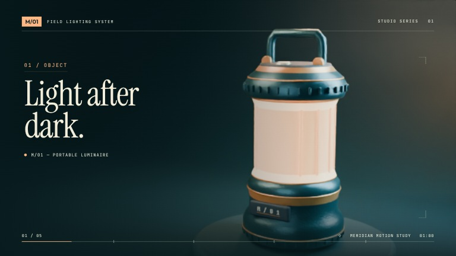

# Meridian M/01 — CPU production framework



**Meridian** is a nine-second field-light design reel: a product reveal, an architectural shelter with a walking guide, a coastal environment, an animated optics section, and a signature card. One [edit decision list](meridian.json) drives the picture cuts, animation durations, stereo score, and closed captions. All plates and graphics are produced without GPU acceleration. See [render verification](VERIFICATION.md) and the [rendered template variants](template-variants.jpg).

**[Download the 1080p film (MP4)](https://github.com/parthoriganal/Parth-/releases/download/meridian-m01-v1/meridian.mp4)** · [editable Blender scenes and production files (ZIP)](https://github.com/parthoriganal/Parth-/actions/runs/44245101395/artifacts/14401578320) · [passing render and export run](https://github.com/parthoriganal/Parth-/actions/runs/44245101395)

The nine-second master passed at **1920×1080, 24 fps** on standard GitHub-hosted Linux CPU runners. The MP4 link is a public GitHub Release download. The separate ZIP (`meridian-production`) requires GitHub sign-in and expires on 2026-12-18. The ZIP includes the MP4, three matching editable Blender scenes, separate captions and score, the Manim plate, and decoded visual proofs.

## Reuse the pieces

| Layer | Entry point | What remains editable |
|---|---|---|
| Product modeling | [`LampSpec` / `luminaire()`](sets.py) | Turned body and lens profiles, knurl count, material and output recipes, modular badge and handle |
| Architecture | [`PavilionSpec` / `portal()` / `pavilion()`](sets.py) | Vault bay spacing/span, piers, cove lights and surface assignments |
| Environment | [`LandSpec` / `terrain()`](sets.py) | Seeded stratification, scree, sea plate and contour geometry |
| Cinematography | [`studio.py`](studio.py) | Authored position/aim/focal keys, product focus pull setup, shaped area lights, the sweep and PBR material recipes |
| Character | [`field_guide()` / `fk_walk()`](character.py) | Separate 13-bone armature, vertex groups, armature modifier and action keys. This is an FK mannequin walk, not mocap, IK, or foot-locking |
| 2D graphics | [`manim_stage.py`](manim_stage.py) | Cairo vector paths, ray reveals, moving traces and grid. The diagram is illustrative, not a photometric measurement |
| Motion graphics | [`motion/index.jsx`](motion/index.jsx) | Typography, lower-third label, time rail, rise/reveal/push presets, alternating wipe and dip, signature card |
| Editorial sound | [`audio.py`](audio.py) | Original stereo synth score; hit cues and authored non-dialogue captions derived from frame time, not speech recognition |

To make another edit, copy `meridian.json`, change labels and eligible templates, and pass `build --project your-edit.json`. Shot IDs are unique; `ticks` use the declared clock (24 here), must align to the selected fps, and are independent of Blender's one-based local shot frames. An `endcard` holds the last plate of a preceding Blender shot. Change geometry and camera settings via the Python template factories and specs; the default Meridian configuration is the tested one.

## Presets and outputs

| Preset | Composited output | Native Cycles plates | Samples | Meridian frames / max batch |
|---|---:|---:|---:|---:|
| `draft` | 768 × 432 @ 12 fps | 640 × 360 | 6 | 108 / 8 |
| `master` | 1920 × 1080 @ 24 fps | 1152 × 648 | 12 | 216 / 14 |

The `master` typography and Cairo plates render at **native 1080p**; its 3D plates are composited up to 1080p. Native 1080p Cycles plates are **not** claimed. The preset uses OIDN, adaptive sampling, bounded bounces, packed fonts, modest mesh budgets, 768-pixel Cycles tiles, a cap of four Cycles threads per worker, and two Chromium composition workers. The workflow partitions plates by **shot and frame range**, with six batches allowed in flight, and does not retain per-frame scene data in Blender. GitHub's availability and billing policies still apply.

[Render Meridian (CPU production)](../.github/workflows/render-meridian.yml) creates `meridian-production`: `meridian.mp4` (H.264/AAC and toggleable English subtitles), `meridian.srt`, the source score WAV, decoded poster/contact sheet, Manim source plate, three portable `.blend` shots, and QA/manifest files. The full artifact is retained for 30 days; the large intermediate PNG artifacts expire after 7. No release, Pages deployment, or binary commit is needed.

## Run the stages on Linux

From the repo root, use Python 3.11 x86_64 and the Blender system libraries in the [CPU setup action](../.github/actions/setup-blender-cpu/action.yml). Install the locked Blender and media wheels into one environment:

```bash
python3.11 -m venv .venv
.venv/bin/python -m pip install --only-binary=:all: --require-hashes \
  -r blender_pipeline/requirements-build.lock -r blender_pipeline/requirements-media.lock
.venv/bin/python -m production build --preset draft
.venv/bin/python -m production matrix
# Render every planned batch sequentially; distinct IDs may also run on separate workers.
set -o pipefail
.venv/bin/python -m production matrix | .venv/bin/python -c \
  'import json,sys; print("\n".join(b["id"] for b in json.load(sys.stdin)["include"]))' | \
  while IFS= read -r batch; do
    .venv/bin/python -m production render --shard "$batch" --threads 2 || exit
  done
```

Keep `out/meridian/bundle` unchanged when resuming: rerun the same shard to skip verified PNGs and regenerate only missing/corrupt frames. Writes are atomic, bound to the scene/render manifest and recorded in a SHA-256 receipt. A normal render error retries with a freshly loaded scene. A cancelled or timed-out hosted job can lose frames not uploaded yet; same-run artifact restoration is best-effort. To render a different project or profile without replacing the current bundle, pass `--root out/new-edit` **before** the stage name.

The optical plate requires Cairo/Pango development libraries (`pkg-config`, `libcairo2-dev`, `libpango1.0-dev`, `fonts-dejavu-core` on Ubuntu). Use a **separate** environment because Manim requires NumPy 2 and the `bpy` wheel requires NumPy 1.26:

```bash
python3.11 -m venv .venv/manim
.venv/manim/bin/python -m pip install --only-binary=:all: --require-hashes \
  -r blender_pipeline/requirements-media.lock
.venv/manim/bin/python -m pip install -r production/requirements-manim.txt
.venv/manim/bin/python -m production manim
.venv/bin/python -m production stage
```

For the Remotion edit, use Node 22 and installed Chrome/Chromium. The verified workflow uses Chromium in CPU mode and local OFL fonts from the repository. Remotion 4's [Free License](https://github.com/remotion-dev/remotion/blob/main/LICENSE.md) covers individuals, for-profit organizations with up to three employees, nonprofits, and noncommercial evaluation; **it is not an unconditional open-source license**. The demo uses the free evaluation path. If you are not eligible, skip the Node install and use the Pillow/FFmpeg compositor below. No paid license or plug-in is required by the free route.

```bash
# Pick ONE composition engine:
npm ci --prefix production/motion --no-audit --no-fund --ignore-scripts
CHROME_PATH=/usr/bin/google-chrome node production/motion/render.mjs out/meridian
# Or, with no Remotion license/dependency:
.venv/bin/python -m production compose

.venv/bin/python -m production export
```

For GitHub Actions, select `compositor: pillow` when manually dispatching the workflow (once it is registered on the default branch) to skip Node/Remotion. The open compositor renders its own simpler typography, title rise, wipes/dips and time rail. Both engines share the same editorial and audio timing. Export fully decodes the MP4, checks dimensions/FPS/frame count and stereo duration, verifies an audible cue at every cut after AAC decoding, round-trips all SRT cues, and makes a contact sheet from decoded frames. It does not promise pixel-identical rendering across CPUs.
