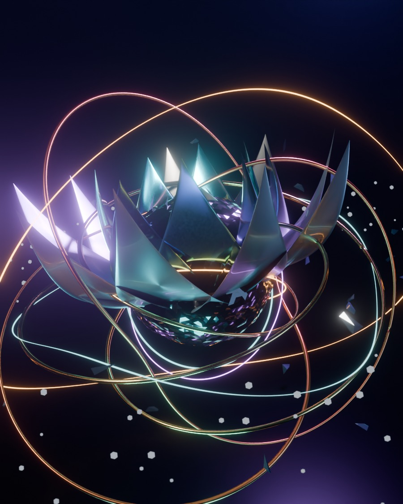

# SINGULARITY BLOOM

> A 3D sculpture that exists only as code. Written in Python, executed by **real Blender 5.0**
> running headless inside a Linux container with no display server, rendered with **Cycles**,
> and shipped as a glTF you can spin in the browser.



---

## What it is

| Layer | What happens |
|---|---|
| **Geometry** | ~90k triangles built from scratch: a noise-displaced chrome core orbited by 3 emissive gyro rings, 25 swept crystal petals, two (p,q) torus knots, 90 convex-hulled shards, 190 dust motes, 2 glowing filaments |
| **Materials** | 10 node-based PBR materials — clear-coated anisotropic metals, transmissive crystal, emissive alloys |
| **Render** | Cycles, CPU, 140 samples, OpenImageDenoise, AgX → linear→display, compositor bloom |
| **Output** | `.blend` scene · `.glb` model · 900×1125 still · 10-frame turntable |
| **Viewer** | three.js + UnrealBloom, OrbitControls, live HUD — `npm run bloom` |

No imported meshes. No textures. No HDRIs. Every vertex is generated by a formula in
[`build_scene.py`](./build_scene.py).

### The parts

```
              dust belt · 190 emissive motes, r 2.8–4.8
                          │
  torus knot (2,3) copper ┤      ╭─ tier 3 · 6 petals · 64° pitch
  torus knot (3,2) gold   ┤      │
                          │  ╭───╯
                          └──┤  chrome core + 3 emissive gyro rings
                             │  ╰───╮
                             ╰──────┴─ tier 1 · 9 petals · 12° pitch
                                       tier 2 · 9 petals · 38° pitch
```

---

## Run it

```bash
# 1. install Blender-as-a-Python-module and shim the X11 libs it wants
./singularity-bloom/setup_bpy_headless.sh

# 2. build + render (add --preview for a ~90 s look-dev pass)
./singularity-bloom/render.sh --width 900 --samples 140

# 3. look at it for real
npm run bloom          # http://localhost:5180
```

`render.sh` flags: `--preview`, `--samples N`, `--width N`, `--turntable N`, `--no-glb`, `--seed N`.

---

## The interesting part: Blender with no display

`pip install bpy==5.0.1` gives you the entire Blender application — Cycles, Geometry Nodes,
the glTF exporter — as an importable CPython 3.11 module. It does **not** work out of the box
on a bare container:

```
ImportError: libXrender.so.1: cannot open shared object file
```

The wheel hard-links against X11 client libraries (`Xrender`, `Xfixes`, `Xi`, `xkbcommon`,
`SM`, `ICE`, `GL`) that a headless image never ships, and `apt` is firewalled here. But Cycles
on CPU never calls a single one of those functions — the loader only needs the *symbols* to
exist. So [`setup_bpy_headless.sh`](./setup_bpy_headless.sh) builds empty stub libraries,
then walks the loader's complaints one `undefined symbol:` at a time, generating no-op shims
until `import bpy` succeeds. It takes ~20 s and is idempotent.

Result: a 960 MB wheel that renders the same image a desktop Blender would.

---

## Files

```
build_scene.py          the entire sculpture — geometry, materials, lights, compositor
render.sh               env + entry point (headless shims, then build_scene.py)
setup_bpy_headless.sh   one-time: pip install bpy + auto-generate the X11 stubs
viewer/                 three.js real-time viewer (index.html, main.js, style.css, vite.config.js)
viewer/assets/model.glb the exported model the viewer loads
docs/bloom-hero.jpg        final Cycles still (README size)
docs/bloom-900x1125.png    the same frame, full resolution
docs/singularity_bloom.blend  the editable scene — open it in any Blender 5.0
docs/turntable.gif         8-frame ping-pong spin
docs/turntable-sheet.jpg   contact sheet of those 8 frames
out/                    (git-ignored) .blend, .glb, full-res renders
```

## Numbers

| | |
|---|---|
| build time | ~6 s (geometry + materials + export) |
| render time | ~12 min @ 900×1125, 200 spp, 2 CPU cores |
| preview | ~75 s @ 480×600, 40 spp |
| model | 1.9 MB GLB · 124 meshes · 92,780 triangles · 62,779 verts · 10 materials |

---

## Downloads

| What | File |
|---|---|
| 3D model (glTF binary, 1.9 MB) | [`viewer/assets/model.glb`](./viewer/assets/model.glb) |
| Blender scene, editable (1.2 MB) | [`docs/singularity_bloom.blend`](./docs/singularity_bloom.blend) |
| Still, 900×1125 PNG | [`docs/bloom-900x1125.png`](./docs/bloom-900x1125.png) |
| Still, JPG preview | [`docs/bloom-hero.jpg`](./docs/bloom-hero.jpg) |
| Turntable GIF | [`docs/turntable.gif`](./docs/turntable.gif) |
| Source of truth | [`build_scene.py`](./build_scene.py) — 600 lines, no assets |

---

Made with [blender/blender](https://github.com/blender/blender) — GPL-2.0-or-later.
The scene script in this folder is MIT, same as the rest of this repo.
